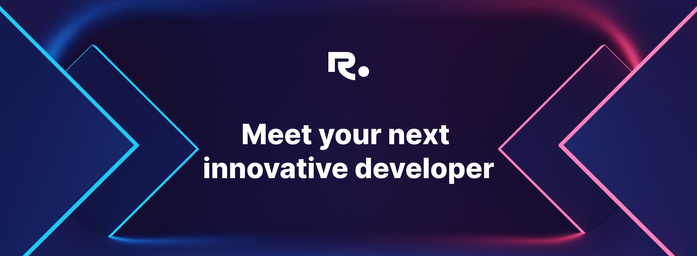

  
  
  

### Introduction

Hi, I'm Reggie, a software engineer who builds products end to end: the services and data pipelines underneath, the APIs connecting them, and the interfaces people actually use. My work spans financial technology, blockchain infrastructure, and AI-powered applications. I care about correctness, resilience, and making complex systems feel simple.

### GitHub Activity

> **A note on my contribution graph:** Most of my day-to-day engineering work happens in private, enterprise-managed GitHub repositories, including client projects. Those contributions aren't reflected on this personal account, which mainly showcases the work I can share publicly. Happy to walk through that work in conversation.

### Now

- **Software Engineer at [Nethermind](https://www.nethermind.io/).** Working on full-stack engineering projects for **Brevan Howard**, building Python-based backend and data workflows alongside React and TypeScript interfaces. My focus is on reliable financial software, usable data experiences, and AI-assisted tooling.
- **Building [RateSense](https://ratesense.co/).** An AI-powered platform that helps creators evaluate brand opportunities, negotiate smarter, and stay organized across deals.

### Before

- **Donations Transparency:** Go and Node ingestion services handling 3K+ daily events, PostgreSQL schemas tuned to sub-100ms, and Stripe webhooks with retry and reconciliation.
- **Payments & mobile:** PayAttitude mobile payments in React Native, a checkout rebuild that cut abandonment 35%, and a platform migration carrying $7M+ monthly volume at 99.9% uptime.
- **Blockchain infrastructure:** Worked on developer-facing products that make complex networks easier to explore, including wallet integrations, design systems, and data-heavy interfaces.

### Selected Work

| Project | What it is | Stack |
| :--- | :--- | :--- |
| **[RateSense](https://ratesense.co/)** | AI-powered deal intelligence and management for creators. | Next.js, TypeScript, Python, PostgreSQL |
| **[Voyager](https://voyager.online/)** | Starknet block explorer. Co-led design system work and built wallet integrations and NFT experiences. | React, Radix UI, Storybook, Jotai, SWR |
| **[Aztec P2P Explorer](https://aztec.nethermind.io/)** | Network explorer with data-driven views of Aztec's peer-to-peer infrastructure. | Next.js, TypeScript, Jotai, SWR |
| **SwapRail** | Self-custody wallet experiences across mobile and browser-extension surfaces. | React Native, Expo, TypeScript |
| **[NigerLan](https://nigerlan.vercel.app/)** | Gamified language-learning platform focused on Nigerian languages. | React, Node.js, MongoDB |

### Toolkit

**Languages:** TypeScript · JavaScript · Python · Go · SQL  
**Frontend & mobile:** React · Next.js · React Native · Expo · Tailwind CSS · Radix UI · Storybook  
**Backend & data:** Node.js · FastAPI · Django · REST APIs · GraphQL · PostgreSQL · Redis · MongoDB · ETL  
**AI & developer tooling:** LLM APIs · Agent workflows · RAG · Claude Code · Cursor  
**Infrastructure & testing:** Docker · AWS · CI/CD · Git · Jest · Playwright · Cypress

---

Happy Coding !!

